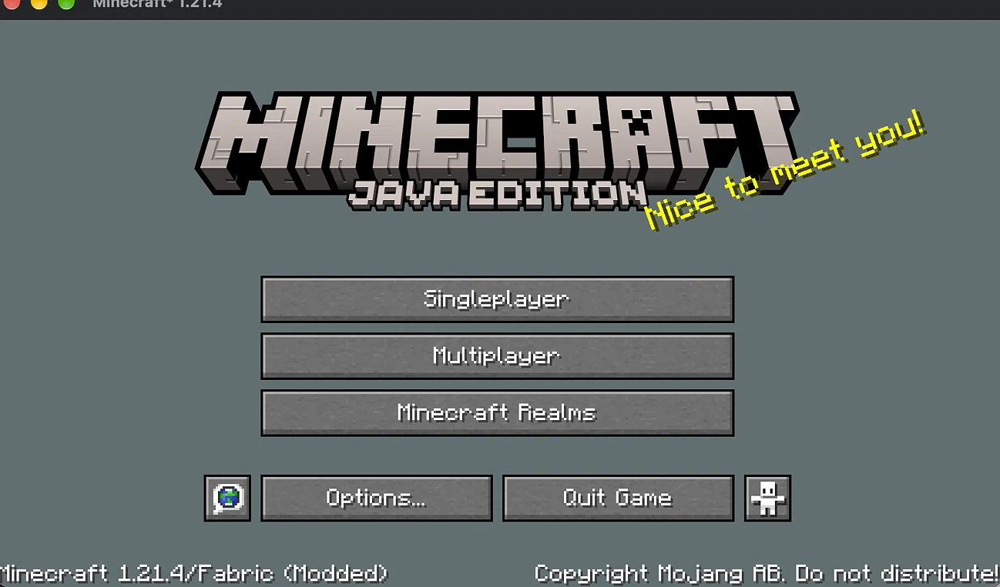
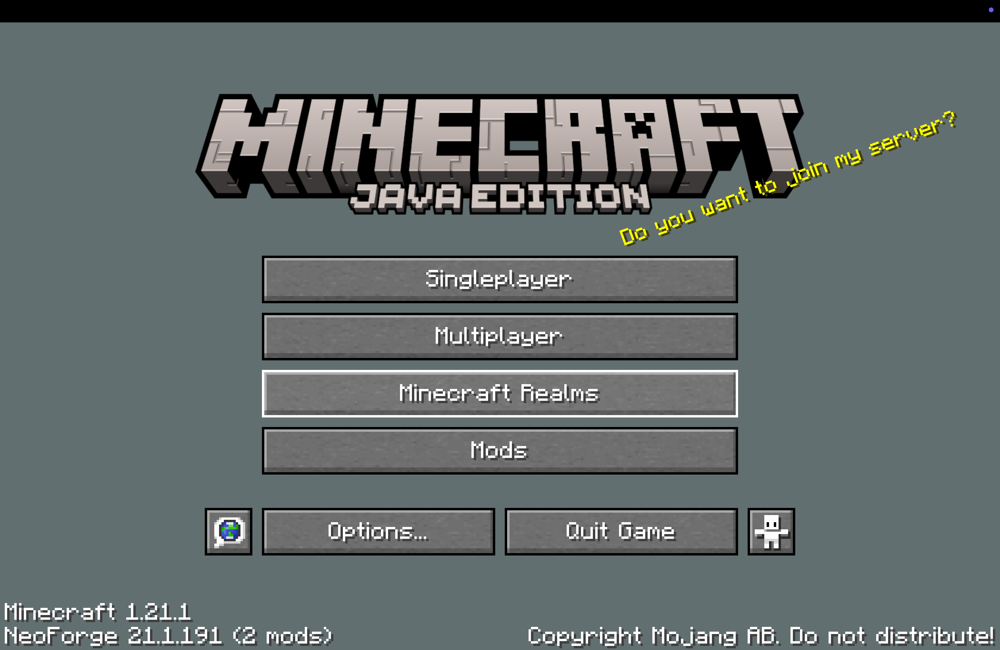
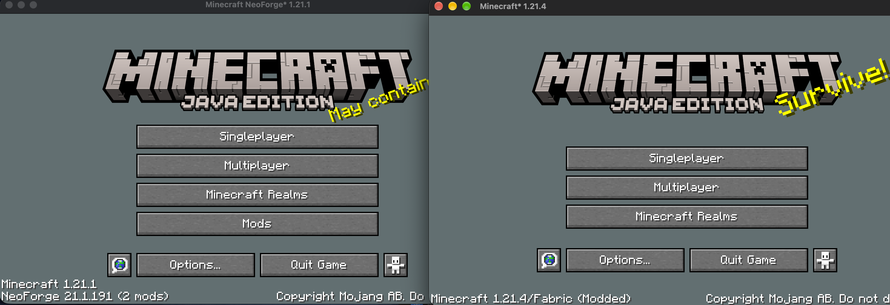
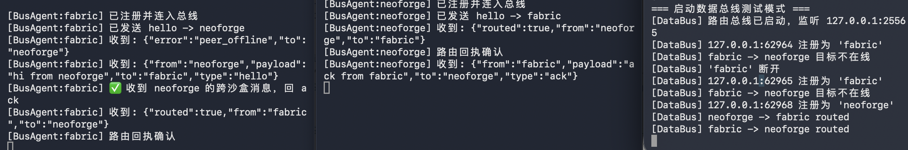
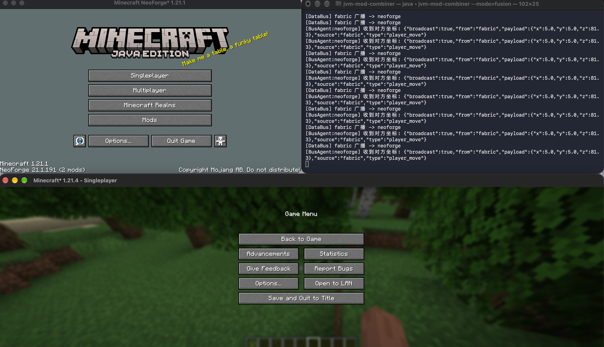

# JVM Mod Combiner

> A Rust-written microkernel that aims to let Fabric and Forge/NeoForge mods
> **coexist inside one JVM**, without depending on Sinytra Connector.

[中文 README](README.zh.md)

## Why

Minecraft's modding ecosystem is split: **Fabric** and **Forge/NeoForge** ship
incompatible loaders, incompatible Mixin conventions, and incompatible event
systems. Existing cross-loader solutions (notably Sinytra Connector) work by
translating one ABI into the other at the bytecode level. That approach is
inherently fragile: every upstream loader release can break the translation
layer.

This project takes a different route. **No translation. Isolate each loader in
its own sandbox, and let them meet only at the data layer.**

## Architecture

Rust Microkernel
(JVM lifecycle, sandbox orchestration, data bus)
|
+--------------+--------------+
| |
+-----v-----+ +-----v-----+
| Sandbox A | | Sandbox B |
| Fabric | | Forge |
| Loader | | Loader |
| + mods | | + mods |
+-----------+ +-----------+

Three design pillars:

1. **Microkernel.** The fusion layer is the only component that owns a JVM. It
   depends on neither Fabric nor Forge.
2. **Runtime sandbox isolation.** Each loader runs inside its own isolated
   `URLClassLoader`. Mod classes never share a parent loader. Same-named classes
   under different loaders do not collide.
3. **Zero-copy data bus (planned).** Cross-sandbox communication goes through a
   memory bus owned by Rust. Mod code on either side never meets; the two
   sandboxes only intersect at the data layer.

## Project status

**Early prototype. Not yet playable.**

Verified on macOS + Temurin 21 (arm64):

- [x] Rust process launches an embedded JVM via JNI
- [x] Rust calls Java static methods and reads back return values
- [x] Rust loads external `.jar` files dynamically through `URLClassLoader`
- [x] Two isolated `URLClassLoader` instances load the same class name and
      produce different behavior
- [x] **Rust JNI boots Minecraft 1.21.4 + Fabric Loader — the main menu renders,
      the sound engine initializes, textures load, and the game runs at a normal
      frame rate**
- [x] **Rust successfully boots Minecraft 1.21.1 + NeoForge 21.1.191 via
      subprocess — the main menu renders, bypassing official launcher
      restrictions and ModLauncher JPMS conflicts**
- [x] Classpath is dynamically assembled from `mc_libraries/` (253 entries);
      Fabric recognizes the game via `fabric.gameJarPath` and classpath isolation
      being disabled
- [x] **Dual-sandbox concurrent launch successful**: Successfully launched Fabric 1.21.4 and NeoForge 1.21.1 simultaneously via Rust subprocesses on the same machine. They run completely isolated from each other and both successfully rendered the main menu.
- [x] **Zero-copy Data Bus (IPC Prototype)**: Implemented a TCP-based message bus in the Rust microkernel, successfully receiving inter-process messages from both Fabric and NeoForge sandboxes.
- [x] **Cross-sandbox message routing (IPC Router)**: A named registration and JSON routing layer in the Rust bus; Fabric ↔ NeoForge `hello`/`ack` round-trip verified with `routed` receipts.
- [x] **Runtime Bytecode Instrumentation**: Rust injects a Java Agent via JNI `InitArgsBuilder`. The `ClassFileTransformer` successfully intercepts classes loaded by Fabric's `KnotClassLoader` (e.g., `net.minecraft.client.main.Main`), proving the capability for future automated patching without Mixin dependencies.
- [x] **Cross-Sandbox Runtime State Sync (Proof of Concept)**: The Fabric sandbox extracts the real-time player coordinates (bypassing obfuscation via reflection) and broadcasts them via the Rust TCP bus. The NeoForge sandbox receives and prints the synchronized state. This proves the viability of real-time data-layer convergence across isolated JVMs.

In progress:

- [ ] Load a real Forge 1.21.4 loader into Sandbox B (Forge 1.16.5 is currently
      blocked by ancient installer zlib hash deadlocks)
- [ ] Resolve the `parent = null` problem for real loaders (they need
      `java.lang.*` and friends)
- [ ] Handle Mixin conflicts between the two sandboxes
- [ ] Zero-copy data bus
- [ ] Dynamic dependency resolution (parse the version manifest instead of
      copying the whole `libraries/` tree)
- [ ] Cross-platform support (Windows / Linux / macOS)

## Proof of Concept & Verification

Here is the visual proof of the microkernel booting both loaders and routing cross-sandbox messages.

### 1. Fabric Loader Boot (MC 1.21.4)
Rust's embedded JNI JVM successfully boots Fabric, rendering the main menu, with sound engine and textures fully initialized.


### 2. NeoForge Boot (MC 1.21.1)
Rust successfully spawns NeoForge via subprocess, bypassing the official launcher restrictions and ModLauncher JPMS conflicts.


### 3. Dual-Sandbox Concurrent Launch
Both Fabric 1.21.4 and NeoForge 1.21.1 running side-by-side in isolated subprocesses on the same machine. They do not interfere with each other.


### 4. Zero-Copy Data Bus Routing (IPC)
The Rust microkernel receives registration requests from both sandboxes. The logs show a bidirectional `hello → ack` message loop successfully routed between Fabric and NeoForge, bypassing the need for a shared ClassLoader.


### 5.Runtime Bytecode Instrumentation
Rust injects a Java Agent via JNI `InitArgsBuilder`. The `ClassFileTransformer` successfully intercepts classes loaded by Fabric's `KnotClassLoader` (e.g., `net.minecraft.client.main.Main`), proving the capability for future automated patching without Mixin dependencies.
```text
[BusAgent:fabric] premain
[BusAgent:fabric] MC-CLIENT: net/minecraft/client/main/Main loader=KnotClassLoader
[BusAgent:fabric] MC-CLIENT: net/minecraft/client/ClientBrandRetriever loader=KnotClassLoader
```

### 6.Cross-Sandbox Runtime State Sync (Proof of Concept)
The Fabric sandbox extracts the real-time player coordinates.


## Quick start

### Requirements

- Rust (stable, 1.75+)
- A JDK. Tested with Temurin 21; JDK 8+ should also work.

### Build and run

git clone https://github.com/hchunhei81-cyber/jvm-mod-fusion.git
cd jvm-mod-fusion

# Point JAVA_HOME at your JDK
export JAVA_HOME=/Library/Java/JavaVirtualMachines/temurin-21.jdk/Contents/Home

cargo run

If everything is wired correctly, you should see:

=== Rust JVM Fusion Kernel: Sandbox Isolation Test ===
[Sandbox A] I am from Sandbox A!
[Sandbox B] I am from Sandbox B!
[OK] If you see A and B above, sandbox isolation is working!

## Tech stack

Rust — kernel, JVM orchestration
jni crate (0.22.4) — FFI bridge to the JVM
Java / JVM — where loaders and mods actually live

## Why not Sinytra Connector

Sinytra Connector translates Fabric mods into something Forge can run at the
bytecode level. It does that surprisingly well, but:

It is fragile by construction: every loader update can break it.
It has to hook deeply into both loaders, so it always lags upstream.
It does not isolate the two loaders; they share one class space.
This project makes a different bet: treat the two loaders as two separate
worlds, and connect them only at the render/data layer.

It may fail. The Mixin conflict problem alone is hard. But if it works, it does
not break when a loader updates, by design.

## Known challenges

- [x] **Successfully resolved ModLauncher initialization and `NullPointerException` (NPE) issues by implementing automated JAR sanitization, exact MANIFEST attribute injection, proper `jopt-simple` and `securejarhandler` dependency paths, and strict JVM VM options ordering (placing `-D` arguments before the main class).**
Forge 1.21+ relies on the Java Module System (--module-path,
BootstrapLauncher, securejarhandler), which must be assembled to match the
official installer exactly.
ModLauncher 10 requires well-formed JAR manifest metadata; anything that
rewrites manifests silently breaks version discovery.
Mixin conflicts across two loaders in one JVM.
ClassLoader hierarchy for real loaders (parent = null is not viable in
practice).

## Roadmap

Load a real Fabric Loader jar into Sandbox A.
Load a real Forge Loader jar into Sandbox B (requires a hybrid parent loader).
Resolve Mixin conflicts — either bytecode merging on the Rust side, or a
priority-based allowlist.
Zero-copy data bus for cross-sandbox communication.
Cross-platform (Windows / Linux / macOS).

## Contributing

Currently a personal research project. Contribution guidelines will be added if
it reaches a usable prototype stage.

## License

BSD 3-Clause. See [LICENCE](LICENCE).
>  **A small request for users**:
> If you are using, testing, or learning from this project, **we highly encourage** you to drop a post in the **[Discussions](https://github.com/hchunhei81-cyber/jvm-mod-fusion/discussions)** tab under the **"Showcase / Test Results"** category, and attach your runtime screenshots, OS info, and mod environment.
> This gives the project a huge boost of motivation, and helps me collect bug reports from various environments (especially weird issues on Windows and Linux) so I can fix and iterate faster.