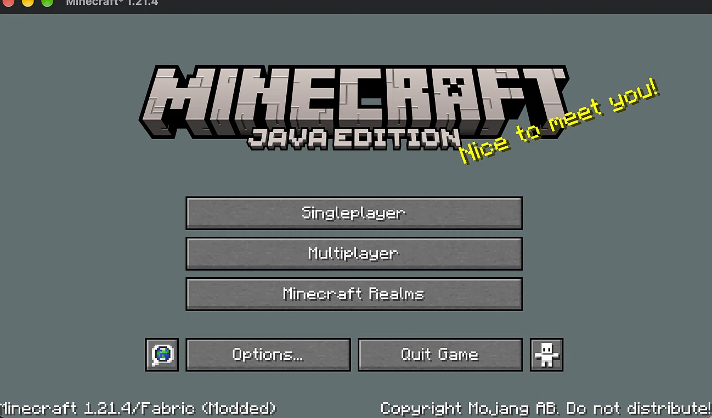
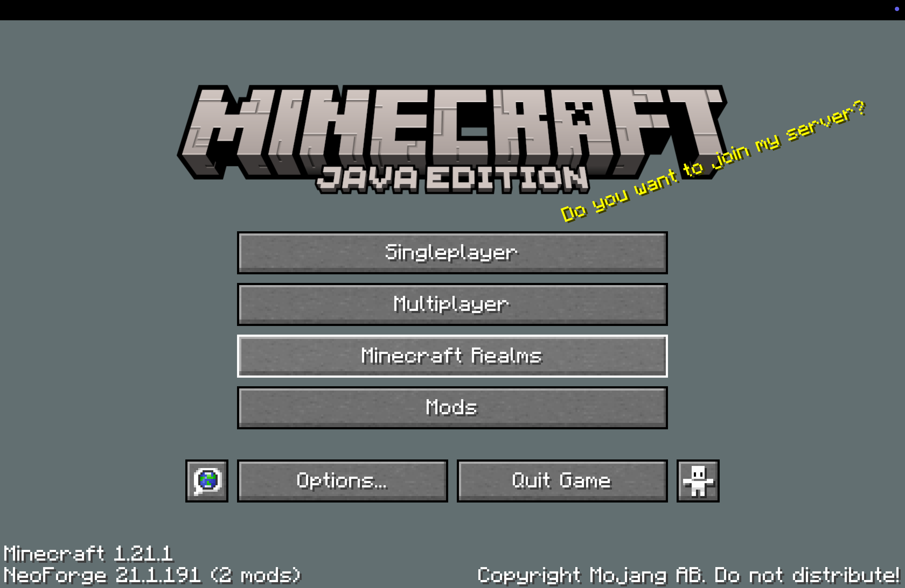
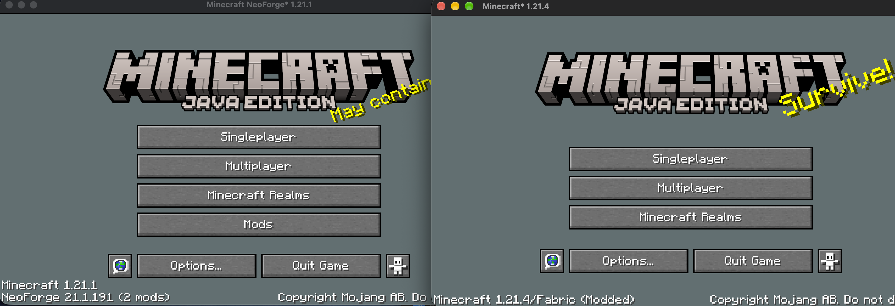
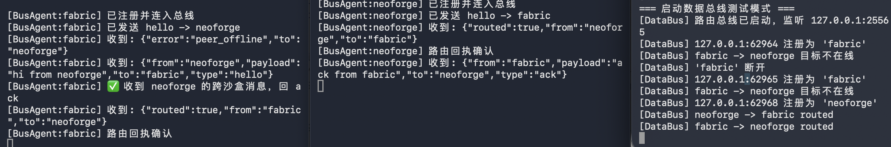
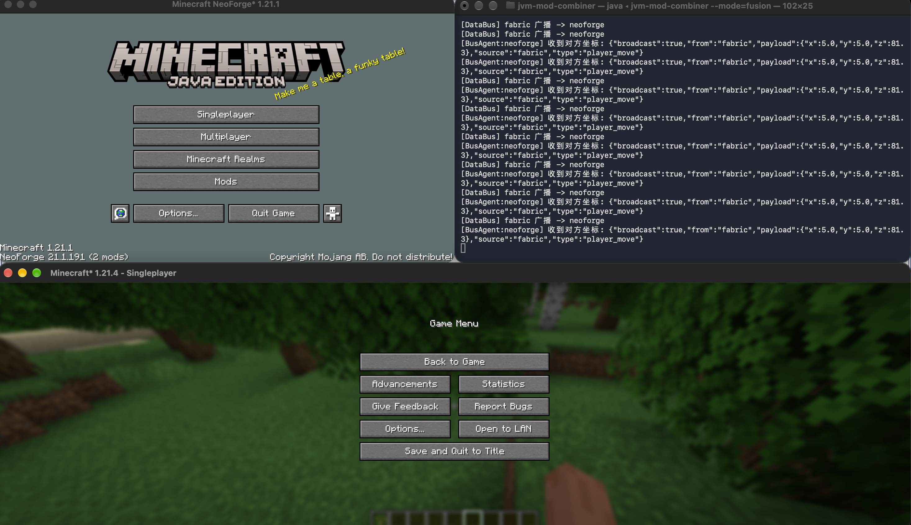
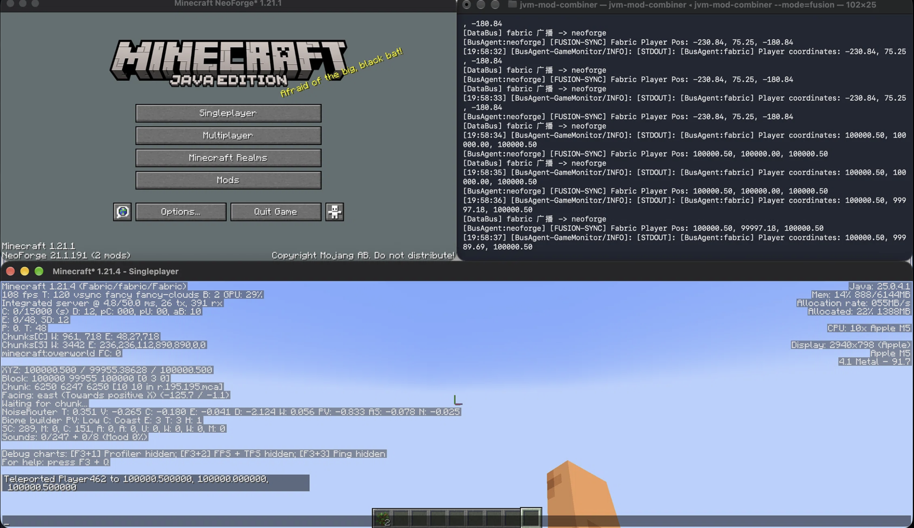
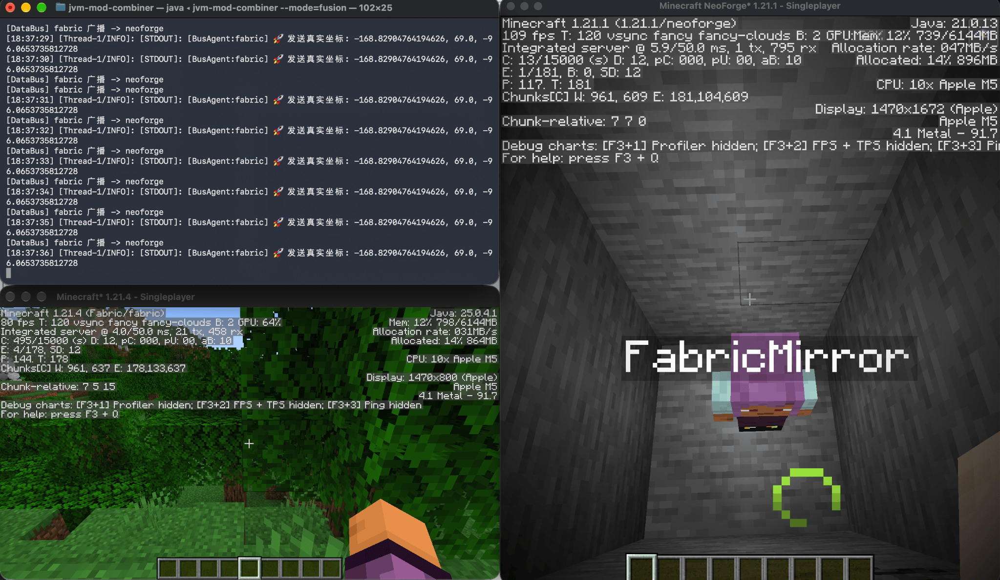
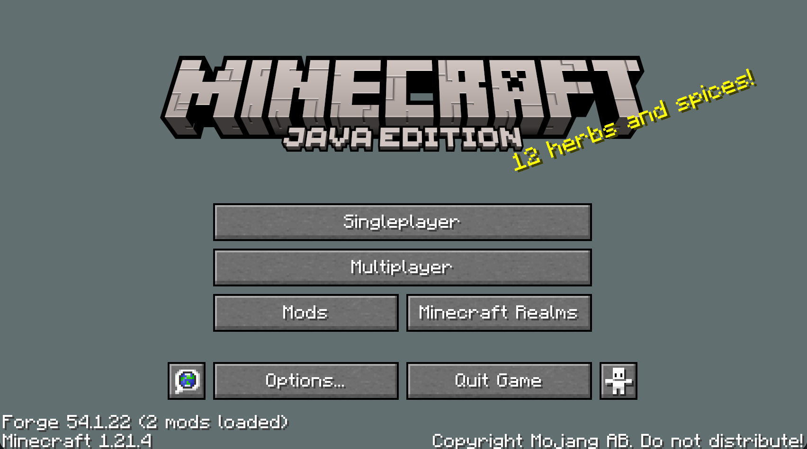

# JVM Mod Combiner

> JVM Mod Combiner is an experimental cross-loader interoperability project written in Rust and Java, focused on reliable one-way player-state synchronization between isolated Fabric and NeoForge environments.

> A Rust-based microkernel prototype exploring how Fabric and Forge/NeoForge environments can coexist through isolated runtime environments and cross-sandbox communication, without depending on Sinytra Connector.

[中文文档](README.zh.md) · [Progress timeline](docs/progress.html) · [Known Problems](problems.md) · [Future challenges](solve.md) · [GitHub Discussions](https://github.com/hchunhei81-cyber/jvm-mod-combiner/discussions) · [TODO](TODO.md)

---

## Why

Minecraft's modding ecosystem is divided between multiple mod loaders.

Fabric and Forge/NeoForge have different:
- Loader initialization pipelines.
- ClassLoader and classpath requirements.
- Mixin integration conventions.
- Event systems and lifecycle management.
- Dependency resolution mechanisms.

Existing cross-loader solutions, notably [Sinytra Connector](https://github.com/Sinytra/Connector), attempt to make mods from different ecosystems compatible through translation and compatibility layers.

JVM Mod Combiner explores a different direction:

**Instead of directly translating one loader's internal environment into another, isolate their runtime environments and connect them through a shared data interface.**

The long-term objective is to reduce direct dependencies between loader implementations and make cross-loader interoperability less sensitive to internal loader changes.

This is an experimental research direction, not yet a replacement for existing compatibility solutions.

## Architecture

### Intended architecture

```text
                  Rust Microkernel
        (JVM lifecycle / sandbox orchestration)
                           |
              Cross-Sandbox Data Interface
                           |
              +------------+------------+
              |                         |
        +-----v------+            +-----v------+
        | Sandbox A  |            | Sandbox B  |
        | Fabric     |            | Forge /    |
        | Loader     |            | NeoForge   |
        | + Mods     |            | + Mods     |
        +------------+            +------------+
```

The architecture is based on three design principles:

### 1. Microkernel

Rust is responsible for orchestration, JVM lifecycle management, dependency preparation, and communication infrastructure.

Loader-specific implementation details should remain outside the kernel wherever possible.

### 2. Runtime isolation

Different loader environments should have independent class-loading boundaries.

The prototype has verified isolated `URLClassLoader` instances loading classes with identical names but producing different behavior.

However, this does not yet mean that two real Minecraft loaders have been successfully isolated inside one JVM.

The current real-loader dual-launch implementation uses separate JVM processes.

### 3. Data-layer interoperability

Different sandboxes should exchange structured game-state information rather than directly sharing loader internals.

The current implementation uses a TCP-based Rust DataBus.

A shared-memory or true zero-copy transport mechanism is a future objective, not a completed feature.

---

## Project Status

<badge color="warning">Early prototype · Not yet playable as a unified environment</badge>

### Verified capabilities

Tested primarily on macOS with Apple Silicon and Temurin JDK 21.

- [x] Rust launches an embedded JVM through JNI.
- [x] Rust invokes Java static methods and reads their return values.
- [x] Rust dynamically loads external JAR files through `URLClassLoader`.
- [x] Two isolated `URLClassLoader` instances can load the same class name and produce different behavior.
- [x] Rust JNI successfully launches Minecraft 1.21.4 with Fabric Loader. The main menu renders, textures load, and the sound engine initializes.
- [x] A previous NeoForge 21.1.191 / Minecraft 1.21.1 configuration was successfully launched through a separate JVM process. The current launcher source targets NeoForge 21.4.161 / Minecraft 1.21.4; verify that newer target separately.
- [x] Rust successfully launches Forge 1.21.4 (54.1.22) to its early loading screen.
- [x] Minecraft libraries and classpaths can be assembled dynamically from local installation metadata and library files.
- [x] Fabric recognizes the Minecraft game JAR through `fabric.gameJarPath` with the tested classpath configuration.
- [x] Fabric 1.21.4 and NeoForge 1.21.1 can run concurrently in separate JVM processes on the same machine.
- [x] A TCP-based DataBus is implemented in Rust.
- [x] Fabric and NeoForge agents can register with the DataBus using separate identities.
- [x] Cross-sandbox JSON message routing has been verified with `hello` / `ack` messages.
- [x] Rust injects a Java Agent through JVM startup arguments.
- [x] The Java Agent's `ClassFileTransformer` has intercepted classes loaded by Fabric's `KnotClassLoader`.
- [x] Fabric can extract local-player coordinates and movement information through reflection.
- [x] Fabric player-state messages have been routed through the Rust DataBus to NeoForge.
- [x] NeoForge can discover its `Minecraft` singleton, `ClientLevel`, and `LocalPlayer` through the Java Agent.
- [x] NeoForge has a proof-of-concept `RemotePlayer` injection path for mirroring Fabric player state.
- [x] Initial mirror removal after Fabric heartbeat timeout has been verified at runtime.
- [x] Initial mirror recreation after Fabric re-enters a world has been verified at runtime.
- [x] Rust DataBus source rejects non-Fabric registered clients publishing protected player and monster state messages.
- [x] A Rust Window Manager and Java bridge register Fabric, Forge, and NeoForge JVM processes; tests cover registration, reconnection, rejection, and PID-based window association.
- [x] macOS read-only on-screen window discovery and an optional read-only Accessibility API probe are implemented. The probe requires the user's macOS Accessibility permission.
- [x] Rust tests pass (36 tests), and the Java bridge harness passes registration, reconnect, and rejection cases for all three loader labels.

### Currently in progress

- [ ] Rebuild and package the Java Agent with the receiver-only NeoForge behavior.
- [ ] Runtime-test the Rust DataBus rejection of non-Fabric authoritative state messages and confirm the sender remains connected.
- [ ] Restrict or authenticate client registration names; the current local DataBus trusts the name supplied in the first `register` message.
- [ ] Improve remote-player identity and entity lifecycle management.
- [ ] Add protocol versioning, schema validation, sequence numbers, and stale-state rejection.
- [ ] Verify disconnect, reconnect, and world-transition recovery.
- [ ] Improve synchronization behavior under latency and packet loss.
- [ ] Rebuild and runtime-test the current working-tree hostile-mob receiver, mirror, and ACK/retry implementation.
- [ ] Implement reliable hostile-mob removal messages and verify reconnect/world-transition recovery.
- [ ] Validate window registration and discovery against live Minecraft windows on macOS, then investigate actual window arrangement/integration. Window movement, resizing, embedding, composition, and Windows/Linux support are not implemented.

**Current authority model:** Fabric is the sole authoritative source of player
movement state. NeoForge receives Fabric state and maintains a remote-player
mirror. Reverse-direction requests or diagnostics may be supported in the
future, but NeoForge must not publish authoritative `player_move` state.

The Rust DataBus source enforces this policy for `player_move`,
`monster_spawn`, `monster_update`, and `monster_remove`: non-Fabric registered
clients receive a `state_authority_violation` response, and the message is not
routed. This is source-level behavior; runtime rejection and connection
continuity still need explicit verification. Registration is currently
self-asserted by the connecting client, so the name is a routing identity, not
an authenticated process identity. The listener binds to loopback.

The Java sources currently live in [`bus_test/`](bus_test/), not a
`bus-agent/` directory. The committed Java sources include Fabric mob sampling,
NeoForge spawn/update mirror handling, and sequence-based ACK/retry. These
changes still need to be rebuilt into and verified in the packaged
`bus_test/bus-agent.jar`, then runtime-tested with Minecraft. Reliable monster
removal is not implemented.

### Not yet implemented

- [ ] True zero-copy or shared-memory DataBus.
- [ ] Fully isolated real Fabric and Forge/NeoForge loaders inside one JVM.
- [ ] General-purpose mod interoperability.
- [ ] Automatic conflict resolution for Mixin configurations.
- [ ] Complete cross-loader event translation.
- [ ] Production-ready Windows and Linux support.

**Important:** The current player synchronization implementation is a proof of concept. It does not establish complete mod compatibility or full gameplay equivalence between different Minecraft versions.

---

## Proof of Concept & Verification

The following images document individual milestones. They are evidence of specific prototype capabilities, not proof that the entire system is production-ready.

### 1. Fabric Loader Boot — Minecraft 1.21.4

Rust's embedded JNI JVM launches Fabric and renders the Minecraft main menu.



### 2. NeoForge Boot — Minecraft 1.21.1

Rust launches NeoForge through a separate JVM process.



### 3. Dual-Sandbox Concurrent Launch

Fabric 1.21.4 and NeoForge 1.21.1 run concurrently in separate JVM processes on the same machine.



### 4. DataBus Routing — IPC Prototype

The Rust microkernel accepts registration requests from both sandbox agents.

The TCP routing layer forwards messages between registered clients.



### 5. Runtime Bytecode Instrumentation

The injected Java Agent uses `ClassFileTransformer` to observe classes loaded by Fabric's `KnotClassLoader`.

Example diagnostic output:

```text
[BusAgent:fabric] premain
[BusAgent:fabric] MC-CLIENT: net/minecraft/client/main/Main loader=KnotClassLoader
[BusAgent:fabric] MC-CLIENT: net/minecraft/client/ClientBrandRetriever loader=KnotClassLoader
```

### 6. Fabric Player-State Extraction

The Fabric sandbox uses reflection to access the local player's runtime state, including coordinates and rotation.



### 7. Fabric-to-NeoForge State Synchronization

Fabric sends player-state messages through the Rust TCP DataBus.

NeoForge receives and parses the messages.



### 8. Cross-Sandbox Entity Mirroring

A proof-of-concept `RemotePlayer` is injected into NeoForge's `ClientLevel`.

The mirror entity can be updated using state received from Fabric.



> Different Minecraft versions and world seeds can produce different terrain. Matching player coordinates do not imply identical world generation.

### 9. Forge 1.21.4 Boot

Rust successfully launches Forge 1.21.4 (54.1.22) to the early loading screen.



---

## Quick Start

### Requirements

- Rust stable toolchain (1.85+; the project uses Rust edition 2024).
- JDK 21 recommended.
- A local Minecraft installation for the loader versions being tested.
- macOS, Windows, or Linux may be used, but the current verification coverage is primarily macOS.

### Clone

```bash
git clone https://github.com/hchunhei81-cyber/jvm-mod-combiner.git
cd jvm-mod-combiner
```

### Configure Java

Example for macOS with Temurin 21:

```bash
export JAVA_HOME=$(/usr/libexec/java_home -v 21)
```

### Build and run

```bash
cargo build
cargo run
```

The default mode runs the basic JVM and class-loader isolation prototype.

Expected output resembles:

```text
=== Rust JVM Fusion Kernel: Sandbox Isolation Test ===
[Sandbox A] I am from Sandbox A!
[Sandbox B] I am from Sandbox B!
[OK] If you see A and B above, sandbox isolation is working!
```

---

## Runtime Modes

All modes are experimental. Runtime crashes and version-specific failures are possible.

### Fabric

```bash
cargo run -- --mode fabric
```

Launches the configured Fabric environment.

### Forge

```bash
cargo run -- --mode forge
```

Launches the configured Forge environment.

### NeoForge

```bash
cargo run -- --mode neoforge
```

Launches the configured NeoForge environment.

### Fusion

```bash
cargo run -- --mode fusion
```

Attempts to launch the configured Fabric and NeoForge environments concurrently and connect them through the Rust DataBus.

> Fusion mode is unstable. The two real Minecraft environments currently run in separate JVM processes. This mode is not yet a playable unified Minecraft client.

### DataBus test

```bash
cargo run -- --mode bus-test
```

Starts the standalone TCP routing service on:

```text
127.0.0.1:25565
```

---

## Known Problems

See [Problems.md](problems.md) for the current technical issue list and investigation notes.

Some major challenges include:

- Real-loader ClassLoader isolation.
- JPMS and ModLauncher bootstrap requirements.
- Mixin compatibility and transformation ordering.
- Version-specific Minecraft mappings.
- Player identity and entity lifecycle synchronization.
- Network reconnection and state consistency.

---

## Why Not Sinytra Connector?

[Sinytra Connector](https://github.com/Sinytra/Connector) is an established compatibility project that aims to run Fabric mods in a Forge/NeoForge environment.

JVM Mod Combiner investigates a different architecture.

Rather than translating one loader's environment into another, it aims to isolate the environments and expose a controlled data interface between them.

Potential advantages of this approach include:

- Reduced direct coupling between loader internals.
- Independent loader lifecycle management.
- Explicit communication boundaries.
- More controlled state synchronization.

However, isolation introduces its own challenges. Cross-loader entity synchronization, event semantics, world state, rendering, and mod behavior are significantly more complex than transferring player coordinates.

This project is research into those challenges, not a claim that they have already been solved.

---

## Roadmap

### Phase 1 — Runtime foundation

- [x] Rust/JNI integration.
- [x] Basic `URLClassLoader` isolation.
- [x] Fabric startup.
- [x] Forge/NeoForge startup experiments.

### Phase 2 — Sandbox communication

- [x] Rust TCP DataBus.
- [x] Named client registration.
- [x] JSON message routing.
- [x] Java Agent integration.

### Phase 3 — Game-state synchronization

- [x] Fabric player-state extraction.
- [x] Fabric-to-NeoForge message delivery.
- [x] NeoForge player discovery.
- [x] NeoForge remote-player injection prototype.
- [x] Initial Fabric-to-NeoForge position and rotation updates.
- [x] Initial mirror removal after Fabric heartbeat timeout.
- [x] Initial mirror recreation after Fabric world reload.
- [x] Rust-side source policy rejects player and monster state messages from non-Fabric registered clients.
- [x] Committed Java sources include a NeoForge hostile-mob mirror and sequence-based ACK/retry path; packaged-agent and runtime verification are pending.
- [ ] Rebuild and package the receiver-only Java Agent.
- [ ] Verify policy rejection at runtime and confirm rejected messages do not disconnect clients.
- [ ] Restrict or authenticate the client-supplied registration identity.
- [ ] Verify DataBus disconnect and reconnect lifecycle behavior.
- [ ] Improve entity identity, lifecycle, and stale-state handling.
- [ ] Add interpolation and synchronization quality controls.
- [ ] Rebuild/runtime-test the current NeoForge hostile-mob receiver and ACK/retry path; implement reliable removal events.

The synchronization model is intentionally asymmetric: Fabric generates
authoritative player state, while NeoForge receives that state and maintains
a remote mirror. This does not prohibit explicitly defined reverse-direction
requests, diagnostics, or interaction messages.

### Phase 4 — Interoperability

- [ ] Player identity and lifecycle protocol.
- [ ] Entity synchronization.
- [ ] Inventory and interaction synchronization.
- [ ] Event and capability bridging.
- [ ] Mixin conflict strategy.

### Phase 5 — Architecture and portability

- [ ] Shared-memory or zero-copy DataBus.
- [ ] Real-loader isolation in one JVM.
- [ ] Dynamic dependency resolution.
- [x] Initial local window registration, PID association, and read-only macOS window observation.
- [ ] Window arrangement, embedding/composition, and live dual-Minecraft validation.
- [ ] Windows and Linux verification.
- [ ] Performance and stability testing.

---

## Contributing

This is currently a personal research project.

Bug reports, test results, and technical discussions are welcome.

If you are testing the project, please consider posting in [GitHub Discussions](https://github.com/hchunhei81-cyber/jvm-mod-combiner/discussions), preferably under **Showcase / Test Results**.

Useful information includes:

- Operating system and CPU architecture.
- JDK vendor and version.
- Minecraft version.
- Loader and loader version.
- Relevant mod list.
- Runtime logs and screenshots.
- Steps required to reproduce the problem.

Reports from Windows and Linux users are especially useful for future cross-platform work.

## License

BSD 3-Clause. See [LICENSE](LICENSE).
