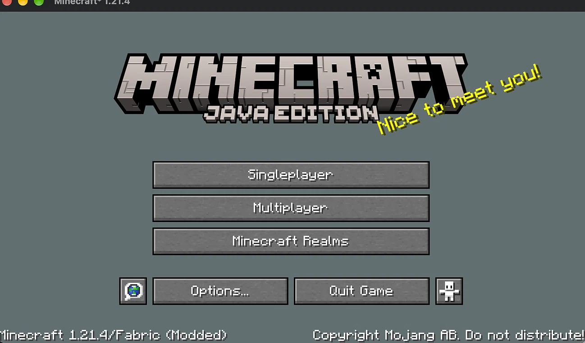
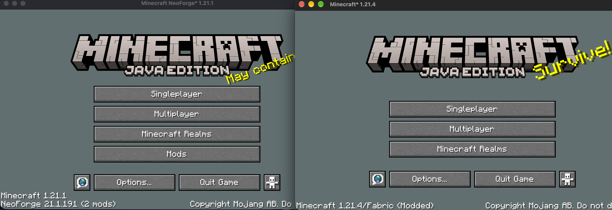
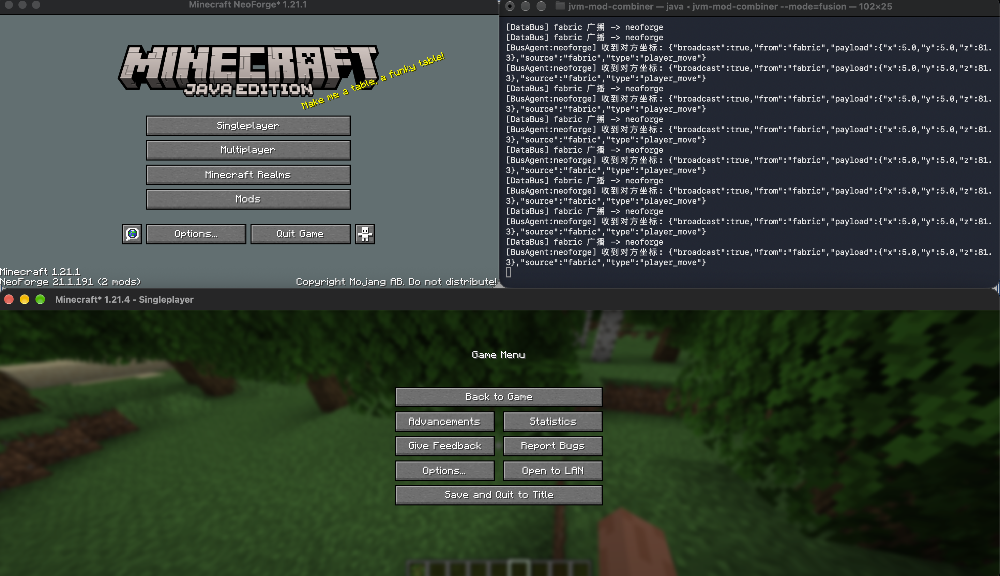
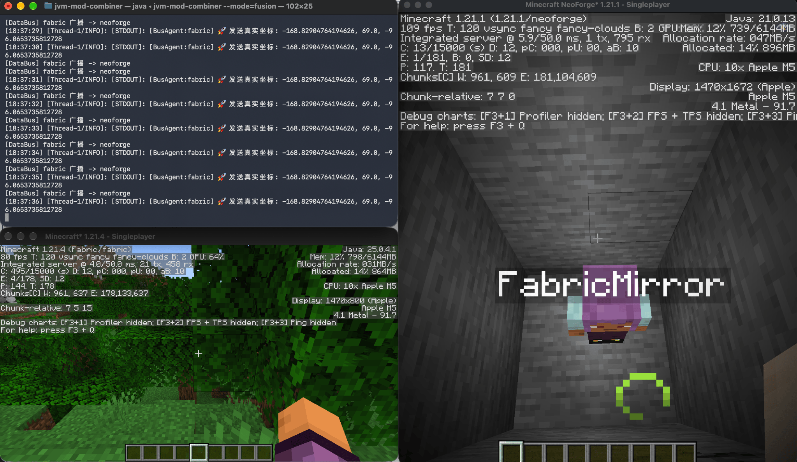
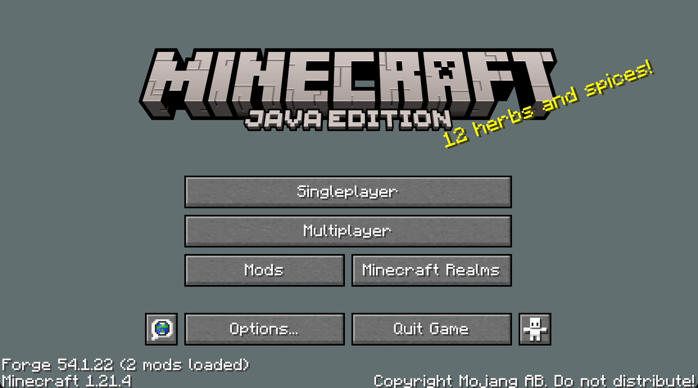

# JVM Mod Combiner


> 一个使用 Rust 和 Java 开发的跨 Loader 互操作研究项目。目标是通过隔离的运行环境和跨沙盒通信，让 Fabric 与 Forge/NeoForge 能够协同运行，而不依赖 Sinytra Connector。

[English README](README.md) · [项目进度时间线](docs/progress.html) · [技术问题清单](Problems.zh.md) · [将来的困难](solve.zh.md) · [GitHub Discussions](https://github.com/hchunhei81-cyber/jvm-mod-combiner/discussions) · [待办路线图](TODO.zh.md)

---

## 项目背景

Minecraft 的模组生态被多个 Mod Loader 分割。

Fabric 与 Forge/NeoForge 在以下方面存在差异：

- Loader 初始化流程。
- ClassLoader 和 Classpath 结构。
- Mixin 集成机制。
- 事件系统与生命周期管理。
- 依赖解析机制。

现有跨 Loader 兼容方案，例如 [Sinytra Connector](https://github.com/Sinytra/Connector)，主要通过兼容层和转换机制，让不同生态中的模组能够协同工作。

JVM Mod Combiner 探索另一条技术路线：

**不直接把一个 Loader 的内部运行环境转换成另一个 Loader 的环境，而是尝试隔离各自的运行环境，并通过数据接口进行通信。**

长期目标是降低不同 Loader 之间的直接依赖，使跨 Loader 互操作不必深度绑定某一个 Loader 的内部实现。

这目前仍然是一个实验性研究方向，并不是成熟的模组兼容替代方案。

## 架构设计

### 目标架构

```text
                    Rust Microkernel
              (JVM 生命周期 / 沙盒编排)
                            |
                   跨沙盒数据接口
                            |
               +------------+------------+
               |                         |
         +-----v------+            +-----v------+
         | Sandbox A  |            | Sandbox B  |
         | Fabric     |            | Forge /    |
         | Loader     |            | NeoForge   |
         | + Mods     |            | + Mods     |
         +------------+            +------------+
```

项目目前围绕三个设计原则展开。

### 1. Microkernel（微内核）

Rust 负责：

- JVM 生命周期管理。
- Loader 沙盒编排。
- 依赖准备与 Classpath 构建。
- 跨沙盒通信基础设施。

尽可能避免让 Rust 内核直接依赖 Fabric 或 Forge/NeoForge 的内部实现。

### 2. Runtime Isolation（运行时隔离）

不同 Loader 应当拥有独立的类加载边界。

目前已经验证：

- 两个独立的 `URLClassLoader` 可以加载同名类。
- 两个 ClassLoader 加载的类可以表现出不同的行为。

但这不代表已经实现了两个真实 Minecraft Loader 在同一个 JVM 中完全隔离运行。

目前真实 Loader 的双端并行启动采用**独立 JVM 进程**。

### 3. Data-layer Interoperability（数据层互操作）

不同沙盒之间不应直接依赖对方的 Loader 内部对象，而应通过结构化数据交换游戏状态。

目前使用 Rust 实现基于 TCP 的 DataBus。

共享内存与真正的 Zero-copy 数据传输仍然属于未来目标，并未完成。

---

## 项目进度

<badge color="warning">早期原型 · 尚未达到统一可玩状态</badge>

### 已验证的功能

主要测试环境为 macOS + Apple Silicon + Temurin JDK 21。

- [x] Rust 通过 JNI 启动嵌入式 JVM。
- [x] Rust 调用 Java 静态方法并获取返回值。
- [x] Rust 通过 `URLClassLoader` 动态加载外部 JAR。
- [x] 两个独立 `URLClassLoader` 加载同名类，并产生不同的行为。
- [x] Rust JNI 成功启动 Minecraft 1.21.4 + Fabric Loader，主菜单、纹理和音频系统正常初始化。
- [x] Rust 曾通过独立 JVM 进程成功启动 NeoForge 21.1.191 / Minecraft 1.21.1。当前启动器源码目标为 NeoForge 21.4.161 / Minecraft 1.21.4；新目标仍需单独验证。
- [x] Rust 成功启动 Forge 1.21.4（54.1.22）并进入早期加载界面。
- [x] 根据本地 Minecraft 安装信息动态组装依赖与 Classpath。
- [x] 在当前测试配置下，通过 `fabric.gameJarPath` 让 Fabric 正确识别 Minecraft Game JAR。
- [x] Fabric 1.21.4 与 NeoForge 1.21.1 可以在同一台机器上通过独立 JVM 进程同时运行。
- [x] Rust TCP DataBus 已经实现。
- [x] Fabric 与 NeoForge Java Agent 可以使用不同身份向 DataBus 注册。
- [x] 已经验证 `hello` / `ack` JSON 消息的跨沙盒路由。
- [x] Rust 可以通过 JVM 启动参数注入 Java Agent。
- [x] Java Agent 的 `ClassFileTransformer` 成功观察到由 Fabric `KnotClassLoader` 加载的类。
- [x] Fabric 可以通过反射获取本地玩家的坐标与移动状态。
- [x] Fabric 玩家状态消息已经通过 Rust DataBus 发送到 NeoForge。
- [x] NeoForge Java Agent 可以找到 `Minecraft` 单例、`ClientLevel` 和 `LocalPlayer`。
- [x] 已经实现 NeoForge `RemotePlayer` 镜像注入的 PoC 路径。
- [x] Fabric 心跳超时后的初始镜像移除已通过运行时验证。
- [x] Fabric 重新进入世界后的初始镜像重建已通过运行时验证。
- [x] Rust DataBus 源码会拒绝非 Fabric 注册客户端发布受保护的玩家和怪物状态消息。
- [x] Rust Window Manager 与 Java Bridge 可注册 Fabric、Forge、NeoForge JVM 进程；测试覆盖注册、重连、拒绝及按 PID 关联窗口。
- [x] 已实现 macOS 只读屏幕窗口发现和可选的只读辅助功能 API 检查；该检查需要用户授予 macOS 辅助功能权限。
- [x] Rust 测试套件通过（36 项），Java Bridge 测试程序也通过三种 Loader 标签的注册、重连和拒绝测试。

### 正在开发

- [ ] 重新构建并打包仅接收端 Java Agent。
- [ ] 运行时验证 Rust DataBus 的非 Fabric 状态消息拒绝逻辑及发送端连接保持。
- [ ] 限制或认证客户端注册名；当前 DataBus 信任首条 `register` 消息中由客户端提供的名称。
- [ ] 更完善的玩家身份和实体生命周期管理。
- [ ] 增加协议版本、模式校验、序列号和过期状态拒绝。
- [ ] 验证断开、重连和世界切换恢复。
- [ ] 改善高延迟和丢包条件下的同步。
- [ ] 重新打包并运行时测试已提交的敌对生物接收、镜像及 ACK/重试实现。
- [ ] 实现可靠的敌对生物移除消息，并验证重连和世界切换恢复。
- [ ] 解决并在真实环境中验证 macOS 窗口修改路径。Rust 源码已有位置/尺寸事务和受保护的回滚，但一次真实操作部分生效且回滚未能确认恢复；目前不能认为该功能可靠。
- [ ] 研究窗口嵌入/合成以及 Windows/Linux 窗口支持。

**当前源码说明：** Java 源码位于 [`bus_test/`](bus_test/)。已提交源码包含 Fabric 怪物采样、NeoForge 生成/更新镜像处理，以及基于序列号的 ACK/重试实现。这些改动仍需重新构建到 `bus_test/bus-agent.jar` 并在 Minecraft 中运行时验证；可靠的怪物移除尚未实现。

### 尚未实现

- [ ] 真正的 Zero-copy / Shared-memory DataBus。
- [ ] 在同一个 JVM 中完整隔离运行真实 Fabric 与 Forge/NeoForge Loader。
- [ ] 通用模组互操作。
- [ ] 自动 Mixin 冲突解决。
- [ ] 完整的跨 Loader 事件转换。
- [ ] Windows 和 Linux 的生产级兼容性验证。

**注意：** 当前的玩家同步只是概念验证。它并不代表已经实现完整的模组兼容，也不代表不同 Minecraft 版本之间拥有完全一致的游戏行为。

---

## PoC 与验证截图

以下截图分别展示项目不同阶段的实验结果，并不代表整个项目已经达到生产可用状态。

### 1. Fabric Loader 启动 — Minecraft 1.21.4

Rust 通过 JNI 启动 Fabric，成功渲染 Minecraft 主菜单。



### 2. NeoForge 启动 — Minecraft 1.21.1

Rust 通过独立 JVM 进程启动 NeoForge。


### 3. 双沙盒并行启动

Fabric 1.21.4 与 NeoForge 1.21.1 在同一台机器上通过不同 JVM 进程并行运行。



### 4. DataBus 路由 — IPC 原型

Rust 微内核接收两个沙盒的注册请求，并通过 TCP 路由层转发消息。


### 5. Runtime Bytecode Instrumentation

Rust 在 JVM 启动参数中注入 Java Agent。

Java Agent 使用 `ClassFileTransformer` 观察 Fabric `KnotClassLoader` 加载的类。

示例日志：

```text
[BusAgent:fabric] premain
[BusAgent:fabric] MC-CLIENT: net/minecraft/client/main/Main loader=KnotClassLoader
[BusAgent:fabric] MC-CLIENT: net/minecraft/client/ClientBrandRetriever loader=KnotClassLoader
```

### 6. Fabric 玩家状态提取

Fabric 沙盒通过反射获取本地玩家的实时状态，包括坐标和旋转信息。



### 7. Fabric → NeoForge 状态同步

Fabric 通过 Rust TCP DataBus 发送玩家状态。

NeoForge 成功接收并解析同步消息。


### 8. 跨沙盒实体镜像

通过反射在 NeoForge 的 `ClientLevel` 中注入 PoC `RemotePlayer`。

镜像实体可以根据 Fabric 发送的状态进行更新。



> 不同 Minecraft 版本和世界种子可能产生不同的地形。玩家坐标一致并不代表世界生成结果相同。

### 9. Forge 1.21.4 启动

Rust 成功启动 Forge 1.21.4（54.1.22），并进入早期加载界面。



---

## 快速开始

### 环境要求

- Rust stable 工具链（1.85+；项目使用 Rust 2024 edition）。
- 推荐 JDK 21。
- 本地 Minecraft 安装及对应 Loader 文件。
- 当前主要验证环境为 macOS，Windows 和 Linux 尚需进一步测试。

### 克隆仓库

```bash
git clone https://github.com/hchunhei81-cyber/jvm-mod-combiner.git
cd jvm-mod-combiner
```

### 配置 Java

macOS + Temurin 21 示例：

```bash
export JAVA_HOME=$(/usr/libexec/java_home -v 21)
```

### 编译与运行

```bash
cargo build
cargo run
```

默认模式运行基础 JVM 和 ClassLoader 隔离测试。

预期输出：

```text
=== Rust JVM Fusion Kernel: Sandbox Isolation Test ===
[Sandbox A] I am from Sandbox A!
[Sandbox B] I am from Sandbox B!
[OK] If you see A and B above, sandbox isolation is working!
```

---

## 运行模式

所有模式目前都处于实验阶段，可能出现崩溃或版本兼容问题。

### Fabric

```bash
cargo run -- --mode fabric
```

启动配置好的 Fabric 环境。

### Forge

```bash
cargo run -- --mode forge
```

启动配置好的 Forge 环境。

### NeoForge

```bash
cargo run -- --mode neoforge
```

启动配置好的 NeoForge 环境。

### Fusion

```bash
cargo run -- --mode fusion
```

尝试并行启动 Fabric 与 NeoForge，并通过 Rust DataBus 建立跨沙盒通信。

> Fusion 模式目前不稳定。两个真实 Minecraft 环境使用独立 JVM 进程运行，尚未成为一个统一的可玩 Minecraft 客户端。

### DataBus 测试

```bash
cargo run -- --mode bus-test
```

启动独立 TCP 路由服务：

```text
127.0.0.1:25565
```

---

## 已知问题

当前技术问题与调查记录请查看 [Problems.md](problems.md)。

主要挑战包括：

- 真实 Loader 的 ClassLoader 隔离。
- JPMS 与 ModLauncher 启动要求。
- Mixin 兼容性和字节码转换顺序。
- Minecraft 版本映射差异。
- 玩家身份和实体生命周期同步。
- 网络重连与状态一致性。

---

## 为什么不使用 Sinytra Connector？

[Sinytra Connector](https://github.com/Sinytra/Connector) 是一个成熟的兼容性项目，目标是让 Fabric 模组能够在 Forge/NeoForge 环境中运行。

JVM Mod Combiner 探索不同的架构：

不直接转换一个 Loader 的内部环境，而是尝试隔离不同 Loader 的运行环境，并通过受控的数据接口连接它们。

这种方案可能带来的优势：

- 减少对 Loader 内部实现的直接依赖。
- 独立管理不同 Loader 的生命周期。
- 建立明确的通信边界。
- 更灵活地实现游戏状态同步。

但隔离也带来了新的挑战。跨 Loader 的实体同步、事件语义、世界状态、渲染和模组行为，远远比传输玩家坐标复杂。

本项目研究的是这些问题，而不是宣称已经解决它们。

---

## 开发路线图

### Phase 1 — Runtime Foundation

- [x] Rust / JNI 集成。
- [x] 基础 `URLClassLoader` 隔离。
- [x] Fabric 启动。
- [x] Forge / NeoForge 启动实验。

### Phase 2 — Sandbox Communication

- [x] Rust TCP DataBus。
- [x] 客户端身份注册。
- [x] JSON 消息路由。
- [x] Java Agent 集成。

### Phase 3 — Game-state Synchronization

- [x] Fabric 玩家状态提取。
- [x] Fabric → NeoForge 消息传递。
- [x] NeoForge 玩家发现。
- [x] NeoForge 远程玩家注入原型。
- [x] Rust 源码拒绝非 Fabric 注册客户端发布受保护的玩家和怪物状态消息。
- [ ] 重新构建并打包仅接收端 Java Agent。
- [ ] 运行时验证拒绝策略，并确认被拒绝的消息不会断开客户端。
- [ ] 限制或认证由客户端自行声明的注册身份。
- [ ] 验证 DataBus 断开和重连生命周期。
- [ ] 改进实体身份、生命周期和过期状态处理。
- [ ] 添加插值与同步质量控制。
- [ ] 重新构建并运行时验证当前源码中的 NeoForge 怪物接收、镜像和 ACK/重试。
- [ ] 实现并验证可靠的怪物移除事件。

同步模型有意采用非对称设计：Fabric 发布权威玩家状态，NeoForge 接收状态并维护远程镜像。未来可以支持明确定义的反向请求、诊断和交互消息，但不得形成第二条权威 `player_move` 状态流。

### Phase 4 — Interoperability

- [ ] 玩家身份与生命周期协议。
- [ ] 实体同步。
- [ ] 物品栏与交互同步。
- [ ] 事件与能力系统桥接。
- [ ] Mixin 冲突解决策略。

### Phase 5 — Architecture and Portability

- [ ] Shared-memory / Zero-copy DataBus。
- [ ] 同一 JVM 中的真实 Loader 隔离。
- [ ] 动态依赖解析。
- [x] 实现本地窗口注册、PID 关联和 macOS 窗口观察。
- [ ] 在真实窗口中验证源码已有的 macOS 位置/尺寸事务与安全恢复；部分修改后回滚失败的问题仍未解决。
- [ ] 窗口嵌入/合成以及双 Minecraft 窗口实测。
- [ ] Windows / Linux 验证。
- [ ] 性能和稳定性测试。

---

## 参与贡献

目前这是一个个人研究项目。

欢迎提交 Bug、测试结果和技术讨论。

如果你正在测试本项目，欢迎在 [GitHub Discussions](https://github.com/hchunhei81-cyber/jvm-mod-combiner/discussions) 的 **Showcase / Test Results** 分类发布测试结果。

建议提供：

- 操作系统和 CPU 架构。
- JDK 发行版与版本。
- Minecraft 版本。
- Loader 名称及版本。
- 相关模组列表。
- 运行日志和截图。
- 可复现问题的操作步骤。

尤其欢迎 Windows 和 Linux 用户提供测试结果，以帮助后续跨平台开发。

## License

BSD 3-Clause。详见 [LICENSE](LICENSE)。
